<div align="center">

<picture>
    <source media="(prefers-reduced-motion: reduce)" srcset="docs/assets/anim/banner.png">
    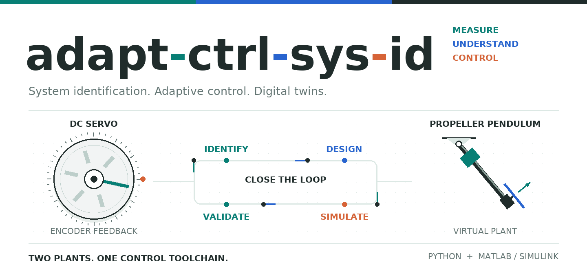
</picture>

**From hardware measurements to adaptive control and a real-time digital twin**

This project identifies, calibrates and controls a DC servo and a propeller
pendulum. One reproducible Python pipeline does the work, and the original
MATLAB/Simulink workflow is kept alongside it.

[](../../actions/workflows/ci.yml)

[](https://github.com/astral-sh/ruff)


</div>

---

adapt-ctrl-sys-id starts from hardware records: steady-state speeds, sine tests, a free
fall, static equilibria and a powered step. It builds models that reproduce
those records, then designs digital controllers on the models and runs them
against a digital twin that speaks a small TCP protocol, as a real-time target
would.
Every number, figure and animation in this README comes from one command:

```bash
adapt-ctrl-sys-id reproduce --realtime 20   # ~2 min, writes docs/assets/ (figures, diagrams, GIFs, results.json)
```

## Highlights

| Topic | What was done | Result |
|---|---|---|
| Servo static map | Quadratic loss term instead of a constant gain | RMS speed error **4.09 → 1.88 rad/s** |
| Servo model | Calibrated virtual servo vs. linear PT1 at the hardware sine tests | Mean magnitude error **1.60 → 1.01 dB** |
| Cascade design | Velocity pole derived from the ±10 V amplifier limit | **2.3 %** overshoot, **9.0 V** peak for a 90° step |
| Adaptive control | Disk inertia ×1.85 mid-run; the loop is re-tuned by RLS + design rule | Overshoot **13.7 % → 3.8 %** |
| Free fall | Fit inertia, viscous damping and air drag | Fit **−16 % → 93 %** (NRMSE) |
| Powered step | Propeller-inflow damping + 44 ms rotor lag | Fit **−10 % → 62 %** |
| Sensor check | Integrated IMU rate vs. potentiometer | IMU axis **inverted**, 0.73 °/s bias found |
| Pendulum control | Pole placement → digital PI-P + feedforward + anti-windup | **J<sub>e</sub> = 1.07 deg²**; plain PI-P diverges from ω = 12 rad/s |
| Digital twin | Same controller as a TCP client against the twin | **J<sub>e</sub> = 1.07 deg²** at 100 Hz |

All values are in [`docs/assets/results.json`](docs/assets/results.json).

Model-fit scores are calibration scores on the supplied records, not
held-out validation. Servo time-domain and closed-loop results are simulations.
The masthead combines accelerated replays of two independent plants; its
moving paths illustrate the workflow, not measured network traffic.

## How it fits together

<p align="center">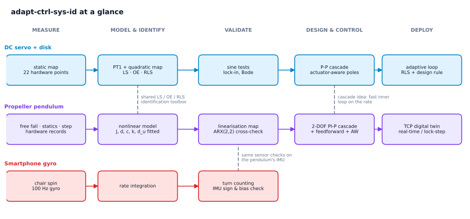</p>

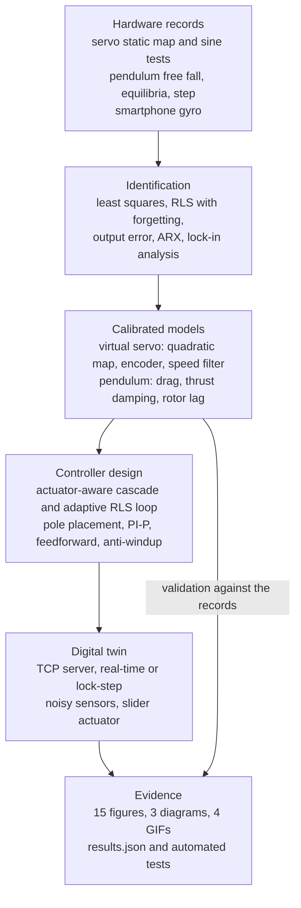

---

## Adaptive Servo Control

The servo turns an inertia disk. Its steady-state speed does not grow linearly
with the voltage, and the gain falls by about 15 % towards full speed. A
quadratic loss term captures that and is still linear in its unknowns:

```math
u = \frac{\omega}{K_0} + \beta\,\omega\,|\omega| \qquad\Rightarrow\qquad K_0 = 28.6\ \tfrac{\text{rad/s}}{\text{V}},\quad \beta = 3.25\cdot10^{-5}
```

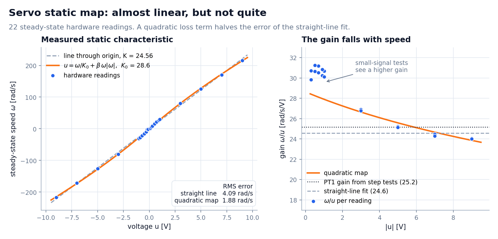

The **virtual servo** combines that static map with a calibrated time
constant, a 2048-count encoder and a filtered finite-difference speed
estimate. A PT1 identified on it reproduces the hardware estimate
(K = 25.17 rad/s/V, T = 0.319 s) to within 1.3 % in gain and 0.03 % in time
constant. Equation-error ARX, output-error fitting and recursive least squares
agree to within about 2 %:

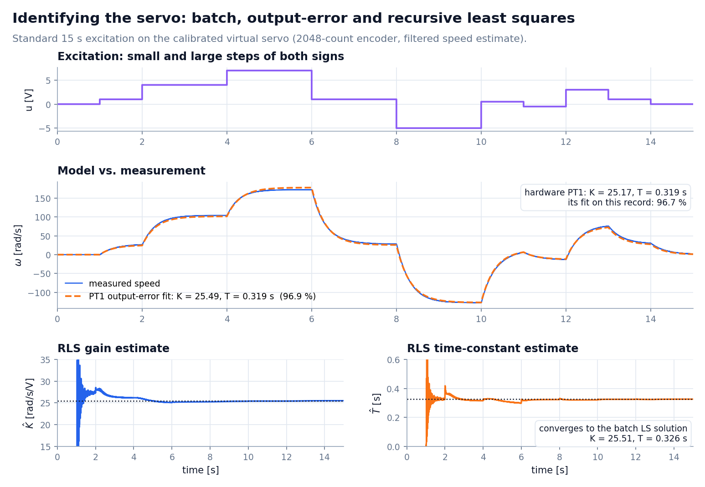

Three sine tests on the hardware validate the model in the frequency domain.
The quadratic map raises the small-signal gain, which brings the model closer
to the hardware than the linear PT1:

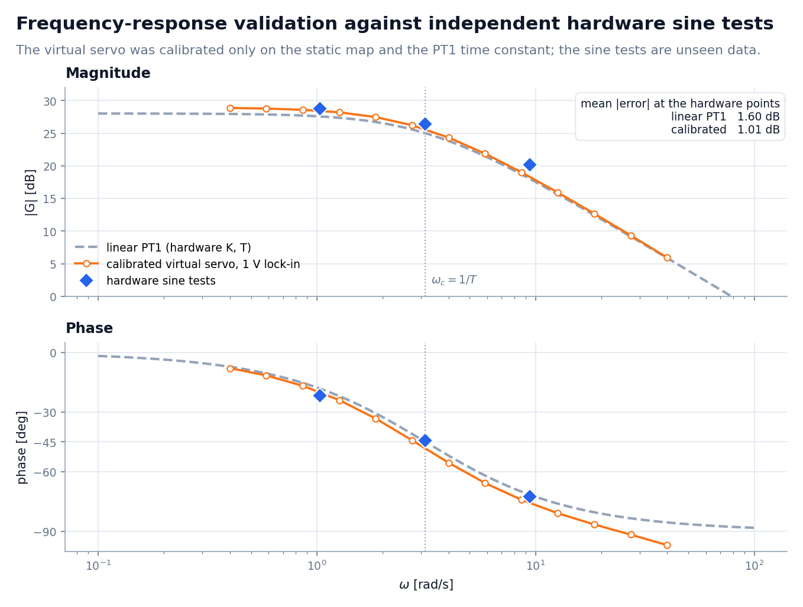

**Cascade design from the actuator limit.** Right after a position step of
height r₀, the cascade outputs u(0⁺) = K<sub>d</sub>K<sub>p</sub>r₀. Requiring
that to stay within the amplifier limit gives the fastest admissible velocity
pole:

```math
s_\text{vel} \ge -\sqrt{\frac{2\,K\,u_\max}{r_0\,T}} = -31.7\ \text{s}^{-1},
\qquad K_d = \frac{-s_\text{vel}T-1}{K},\qquad K_p = \frac{(1+K_dK)^2}{2\,T\,K_dK}
```

The rule of thumb `round(-44.3 + 43 T)` gives −31 here, close to this limit.
The design uses 95 % of the limit.

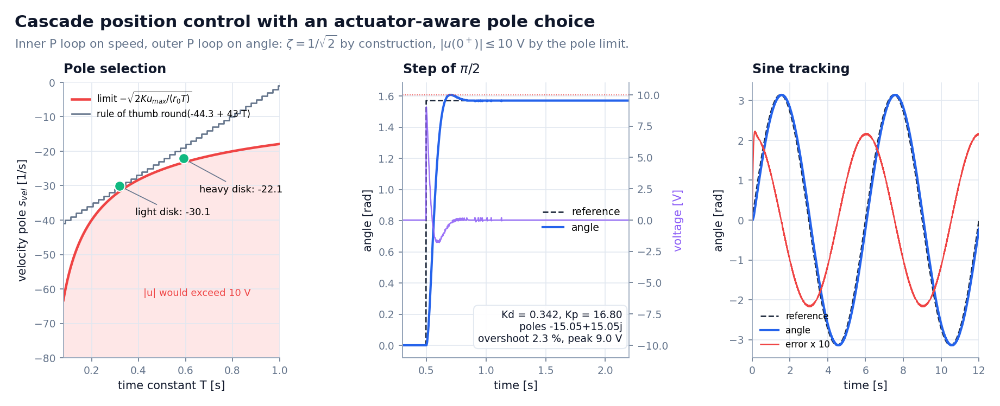

**Adaptive control.** At t = 4.9 s the disk becomes 1.85× heavier. A
fixed-gain loop starts to overshoot. The adaptive loop estimates a model of the
*encoder increments* with RLS, which is exact for a zero-order-held K/(s(Ts+1)).
That keeps quantisation noise from biasing the estimate. The loop then pushes
the estimate through the same design rule:

<p align="center">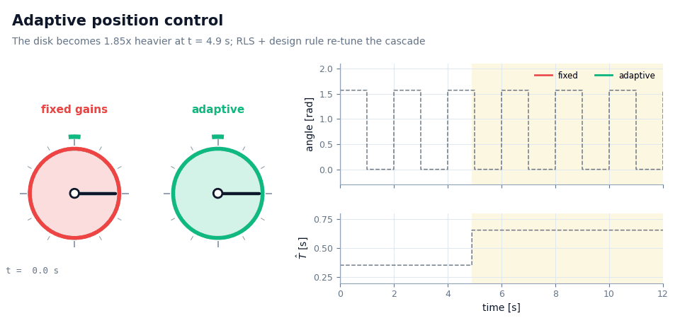</p>

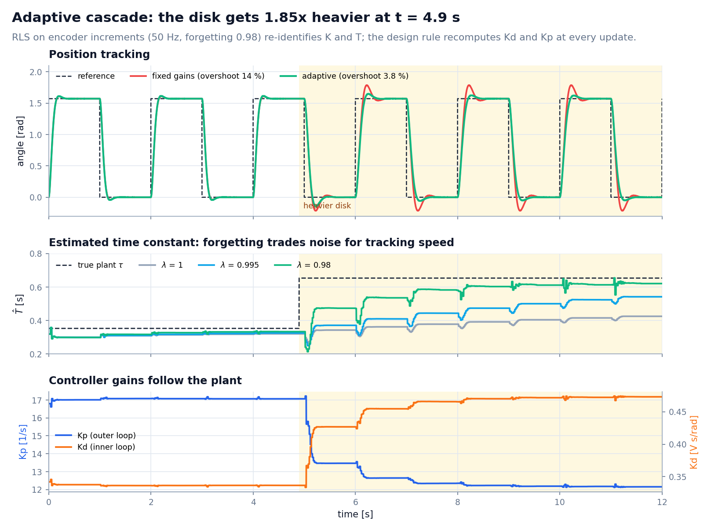

<p align="center">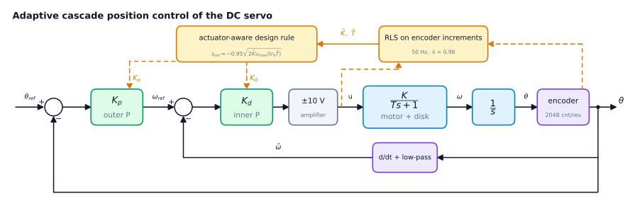</p>

More detail: [docs/servo.md](docs/servo.md)

---

## Nonlinear Plant Calibration

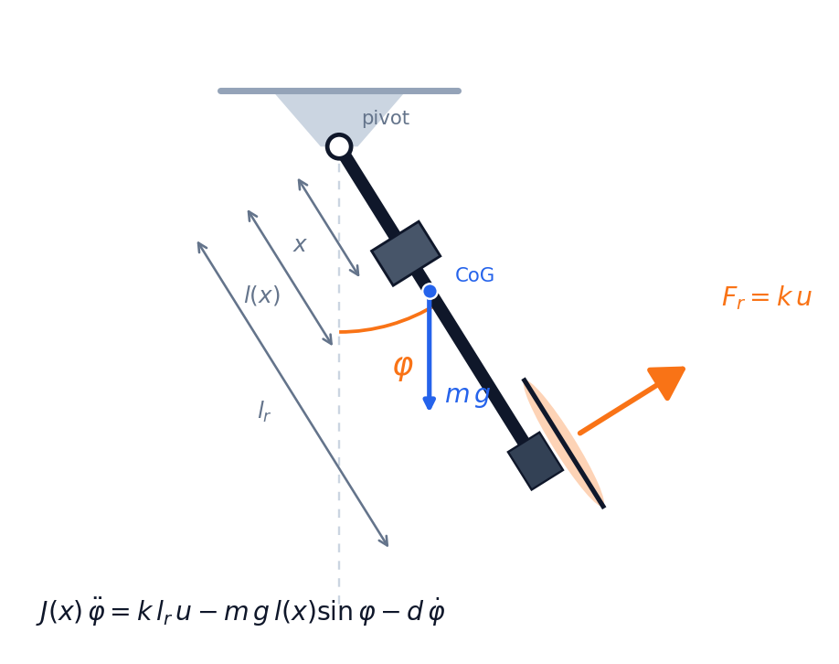

The geometry gives a first model. Three hardware experiments then calibrate
it:

```math
J\,\ddot\varphi = b_0\,w - a_0\sin\varphi - (d + d_u w)\,\dot\varphi - c\,\dot\varphi\,|\dot\varphi|,
\qquad \tau_r\,\dot w = u - w
```

**Free fall.** The pendulum is released from 91° with the rotor off. With the
geometry inertia, the model drifts out of phase over the 60 s record. Fitting
J, d and the quadratic drag c lifts the fit from −16 % to 93 %. An energy
argument bounds the inertia independently (J ≤ 0.0582 kg m²):

<p align="center">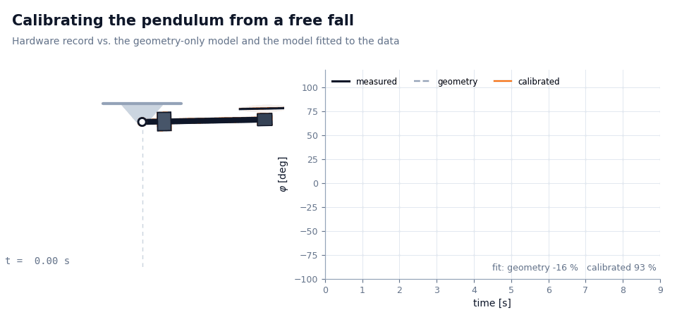</p>

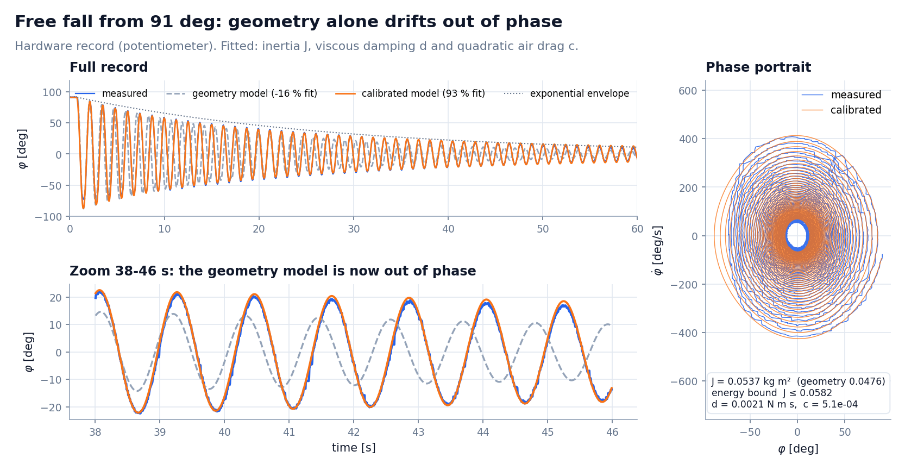

**Static equilibria** give the thrust map (k = 0.0526 N/%, with a dead band
below about 6 %). Two slider positions with the same command give the centre
of gravity without weighing anything:

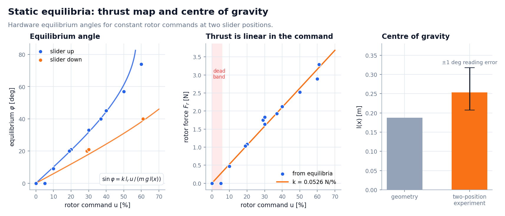

**Powered step.** The first swings decay much faster than the free fall
predicts. A thrust-dependent damping term d<sub>u</sub>·u (propeller inflow)
and a 44 ms rotor lag explain it. A discrete ARX(2,2) model, sampled at 50 ms
with anti-aliasing, gives the same physics independently:
a<sub>0,lin</sub> = 1.106 N m against 1.110 N m from the model.

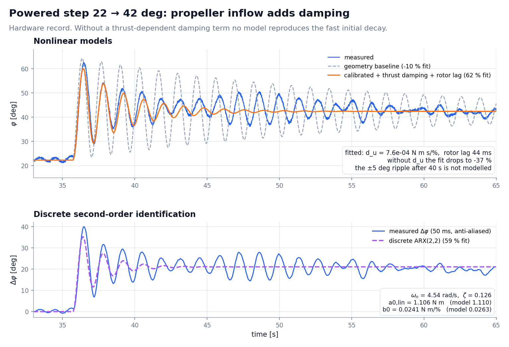

**How far does the linearisation hold?** For steps up to ±2° the linear model
stays within 0.71° everywhere. Around 40°, a ±10° step already costs 11.6°.
Where the nonlinear response passes the horizontal, the linear model has no
chance:

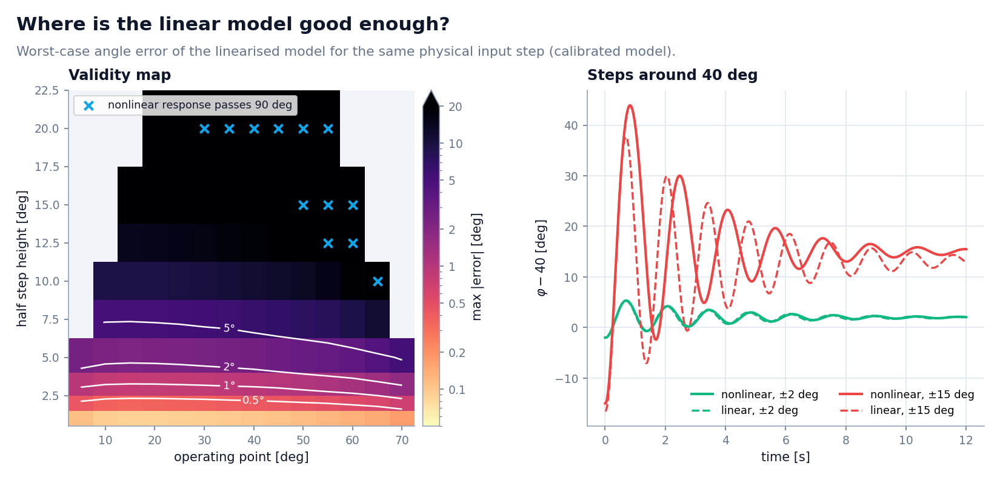

**Sensor sanity checks.** Integrating the IMU rate and comparing it with the
potentiometer exposed an inverted axis, a 3.4 % scale error and a 0.73 °/s
bias. A smartphone gyro on a spinning chair shows why turn counting needs the
sign of every rotation:

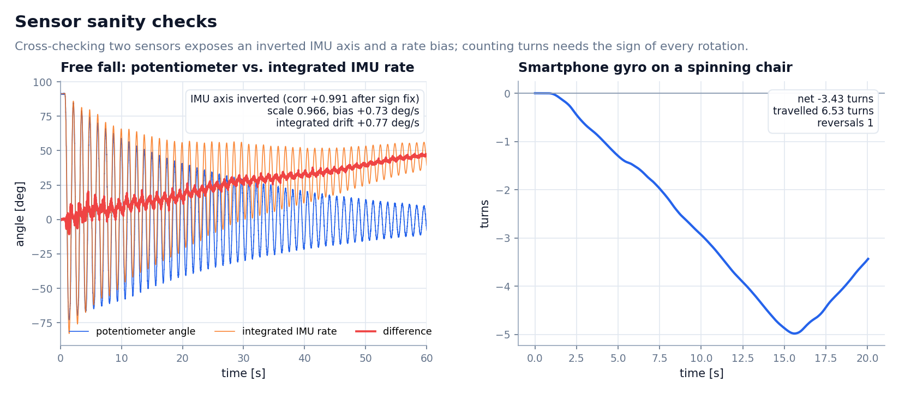

More detail: [docs/pendulum.md](docs/pendulum.md)

---

## Networked Digital Twin

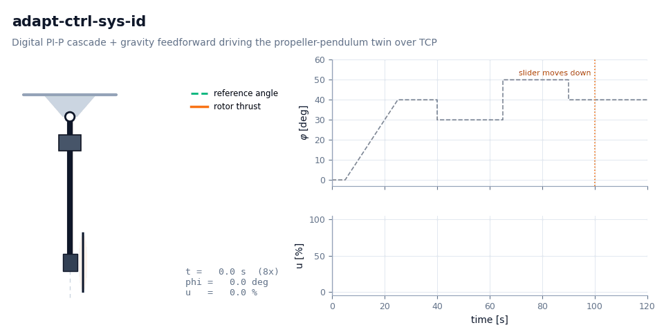

The simulation replay above shows the TCP-controlled pendulum. At 100 s the
slider moves down, changing the plant while the controller keeps tracking.

The pendulum is linearised at 40°. The design places the closed-loop poles at
a<sub>2</sub>(s + αω)(s² + 2ζωs + ω²) with ω = 8 rad/s, ζ = 0.9 and α = 1.
The PI-D law (derivative on the measurement) is implemented as a **digital
PI-P cascade** at 100 Hz:

```math
u_{PI}[k] = u_{PI}[k-1] + q_{0,PI}\,e[k] + q_{1,PI}\,e[k-1], \qquad u[k] = q_{0,P}\,\bigl(u_{PI}[k] - \dot\varphi[k]\bigr) + u_{ff}
```

<p align="center">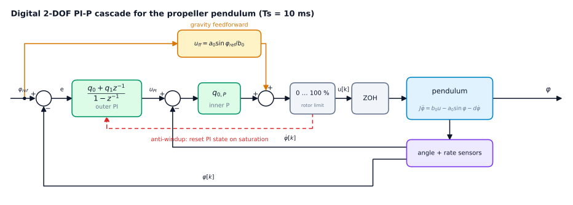</p>

The 2-DOF structure avoids derivative kick on reference steps.
Gravity feedforward u<sub>ff</sub> = a<sub>0</sub> sin r / b<sub>0</sub>
removes most of the integrator's work. Anti-windup by conditioning keeps the
loop stable when the rotor saturates.

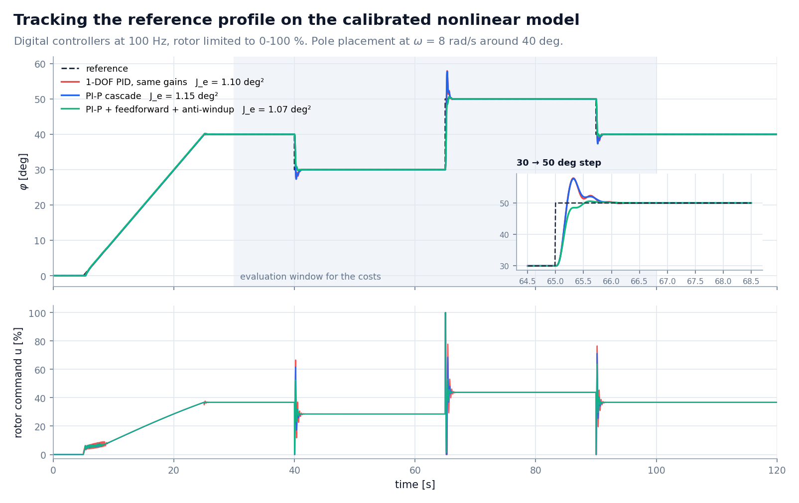

The bandwidth sweep shows why anti-windup matters. Above ω = 10 rad/s the
plain PI-P winds up against the 0–100 % limits and loses the pendulum.
Anti-windup alone is enough to prevent that; feedforward alone is not.

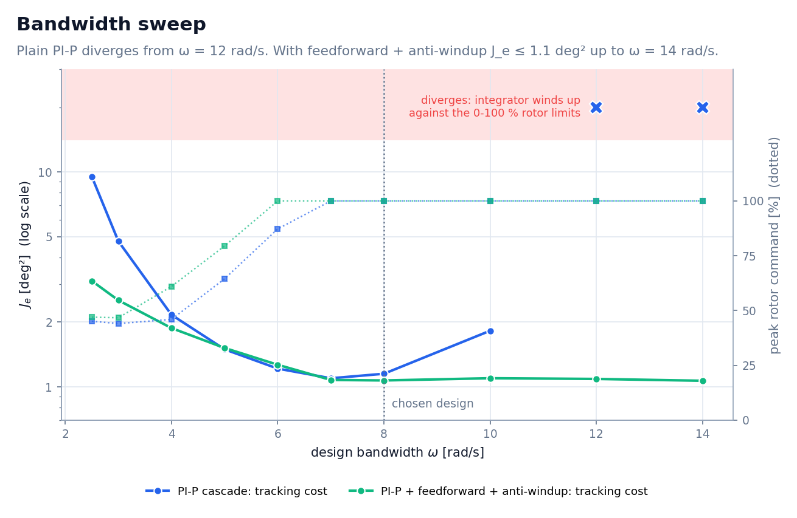

**The twin.** A TCP server wraps the calibrated physics with rotor lag, dead
band, sensor noise and a rate-limited slider. It runs either wall-clock paced
(real time) or lock-step (deterministic, for CI). The controller runs as a
client and sees exactly what a real-time target would see:

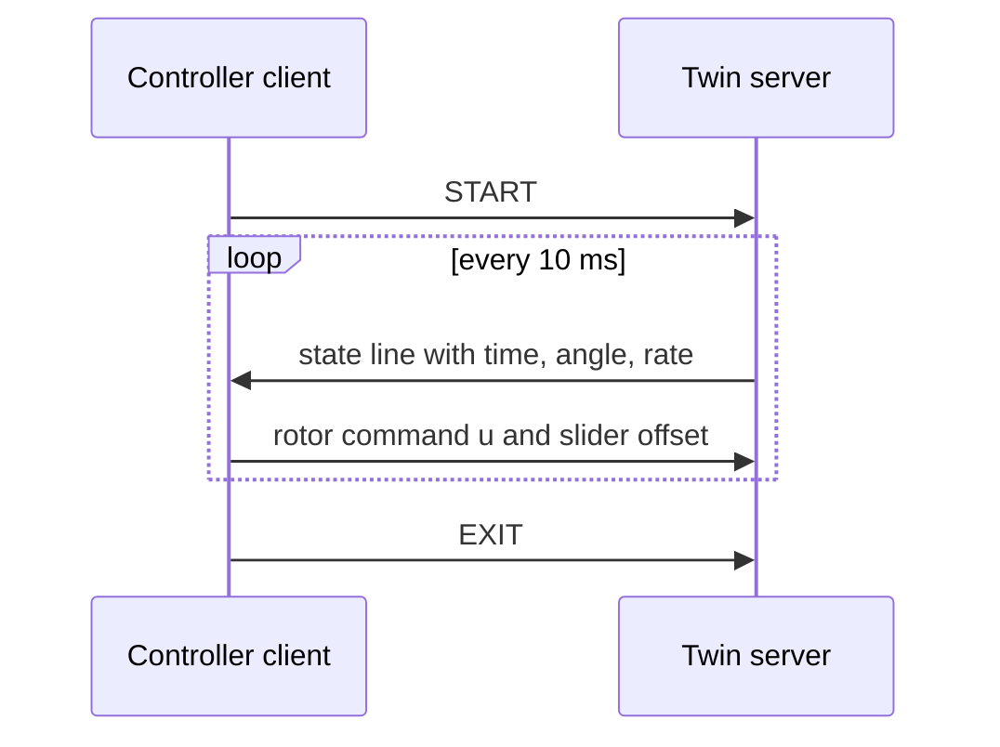

```text
twin -> client   <PP><t>12.3400 </t><PA>40.1000 </PA><PAD>-0.5000 </PAD></PP>     (s, deg, deg/s)
client -> twin   37.250000;0.000000                                                (rotor %, slider mm)
```

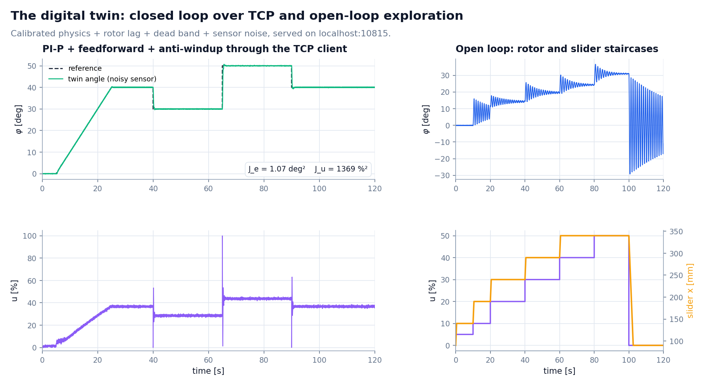

A desktop OS is not a real-time OS. The timing figure shows how often a
wall-clock-paced 10 ms loop is late and how the server catches up:

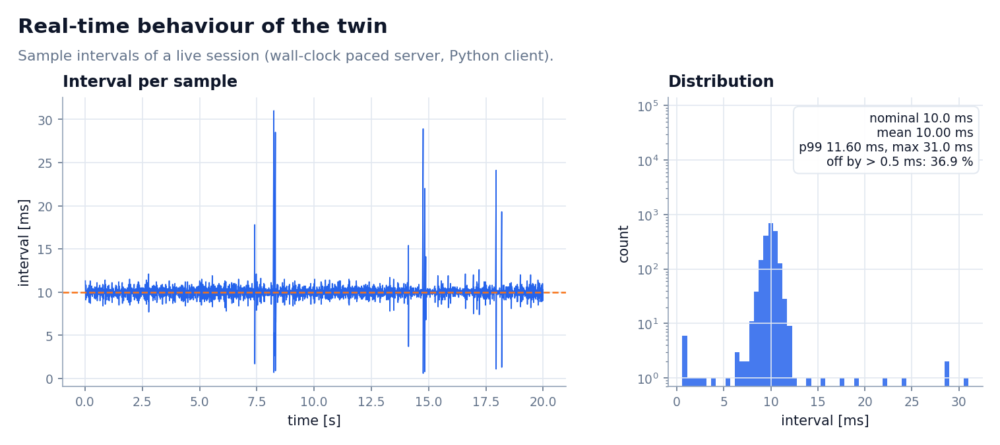

More detail: [docs/control-and-twin.md](docs/control-and-twin.md)

---

## Quick start

```bash
git clone <this repository> adapt-ctrl-sys-id && cd adapt-ctrl-sys-id
python -m pip install -e ".[dev]"

adapt-ctrl-sys-id reproduce             # every study -> docs/assets (add --fast --no-animations for a quick check)
adapt-ctrl-sys-id info                  # calibrated parameters and the controller design
pytest                                  # includes reproduction and animated-banner checks
```

Run the twin and a controller in two terminals:

```bash
adapt-ctrl-sys-id twin serve                # real-time twin on 127.0.0.1:10815 (add --lockstep for deterministic runs)
adapt-ctrl-sys-id twin run --save run.csv   # PI-P + feedforward + anti-windup client, 120 s
```

Any client that speaks the protocol works, including the MATLAB client in
[`matlab/control/twin_pip_client.m`](matlab/control/twin_pip_client.m).

## Repository layout

```text
adapt-ctrl-sys-id/
├── src/adapt_ctrl_sys_id/
│   ├── identification.py   least squares, RLS with forgetting, ARX, output error, static maps
│   ├── frequency.py        correlation (lock-in) frequency-response analysis
│   ├── servo.py            virtual servo, cascade design, adaptive controller
│   ├── pendulum.py         geometry, nonlinear model, free-fall fit, linearisation
│   ├── control.py          pole placement, digital PI-P, 1-DOF PID, closed-loop simulation
│   ├── gyro.py             rate integration and turn counting
│   ├── twin/               TCP twin: physics, server, client, protocol, timing analysis
│   ├── pipeline.py         the three studies behind every number in this README
│   ├── viz/                figures, block diagrams and GIFs
│   └── cli.py              the `adapt-ctrl-sys-id` command
├── tests/                  pytest suite
├── data/                   hardware records (CSV) with provenance notes
├── docs/                   deep dives and generated assets
├── matlab/                 MATLAB scripts and Simulink model builders
└── .github/workflows/      CI: ruff, pytest on Python 3.10–3.14, fast reproduction, MATLAB lint
```

## Data

The CSV files in [`data/`](data) are the hardware records. Sign conventions,
units and resampling are documented in [`data/README.md`](data/README.md).

| Record | Source | Used for |
|---|---|---|
| `servo_static_map.csv` | Servo hardware, 22 steady-state speeds | Static map |
| `servo_frequency_response.csv` | Servo hardware, 3 sine tests | Model validation |
| `pendulum_free_fall.csv` | Pendulum hardware, potentiometer + IMU | Inertia, damping, drag, IMU check |
| `pendulum_static_equilibrium.csv` | Pendulum hardware, 13 equilibria | Thrust map, centre of gravity |
| `pendulum_step_response.csv` | Pendulum hardware, powered step | Thrust damping, rotor lag, ARX |
| `gyro_chair_spin.csv` | Smartphone gyroscope | Turn counting |
| `servo_excitation_profile.csv` | Experiment definition | Identification input |

The servo **time-series** experiments run on the calibrated virtual servo.
Identification, cascade and adaptive control all use it, and the constants
identified on the physical servo serve as the reference it must reproduce.

## MATLAB & Simulink

[`matlab/`](matlab) contains the same analyses as MATLAB scripts that share
one parameter file and read the CSV records. It also has two **Simulink model
builders** that generate the cascade and the digital PI-P models with
`add_block`/`add_line`, so no binary model files are versioned. CI lints the
folder with MISS_HIT.

## License

[MIT](LICENSE)
